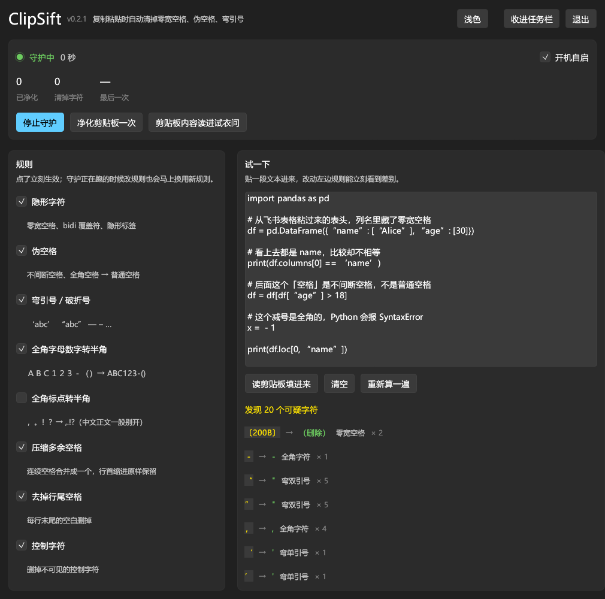

# ClipSift

> Strip invisible characters from your clipboard: zero-width spaces, fake spaces,
> curly quotes, full-width letters.

**English** | [中文](README.md)

**Pasted C++ from a web page and the compiler says `stray '\342' in program`?**
**Copied Python from Feishu / Notion / Lark and got `IndentationError`?**
**Excel `VLOOKUP` refuses to match two numbers that look identical?**

Not your fault. The text has invisible characters in it. ClipSift takes them out.

```
copy → clean automatically → paste
         ^^^^^^^^^^^^^^
         ClipSift works here
```

## Why you need this

`U+200B` zero-width space (ZWSP), `U+00A0` no-break space (NBSP), `U+2028` line
separator, `U+FEFF` BOM, `U+201C/201D` curly quotes — these characters **look
exactly like normal text**, but they are not the same bytes.

| Situation | What you see | Actual cause |
| --- | --- | --- |
| Paste C++ from a web page | `error: stray '\342' in program` | a `U+200B` slipped into the line |
| Copy Python from Feishu/Notion | `IndentationError: unexpected indent` | indentation is NBSP, not spaces |
| Copy code from Word | syntax errors everywhere | full-width punctuation + curly quotes |
| Excel/ERP exported CSV | `VLOOKUP` won't match | trailing `U+00A0` in the cell |
| Mysterious CLI errors | `command not found` on identical-looking text | copied `U+00A0` instead of a space |
| Prompt-injection by paste | invisible instructions hidden in source | `U+E0000` Unicode Tag / bidi overrides |

Rich-text clipboards from AI chat windows, coding assistants and document editors
are the worst offenders.

- Search by the exact error message → [Troubleshooting index](docs/troubleshooting.md)
- The Feishu/Lark case in depth → [Why copying code from Feishu breaks](docs/feishu-copy-paste.md)

## Install

### Windows: run the installer (recommended)

Download **`ClipSift-setup.exe`** from
[Releases](https://github.com/soybeanmilka/clipsift/releases) and double-click it.

Or from a terminal:

```powershell
winget install soybeanmilka.ClipSift
```

What you get:

- Installs per-user into `%LOCALAPPDATA%\Programs\ClipSift` — **no admin rights**, no UAC prompt
- Optional "start with Windows" and "desktop shortcut" checkboxes
- Uninstall via Settings → Apps: program files, Start menu entry, desktop icon and the
  autostart entry are all removed, and it asks whether to keep your rule settings

Prefer a portable copy? `clipsift-windows-x86_64.zip` is unzip-and-run.

### Other platforms

| Platform | File | Install |
| --- | --- | --- |
| Linux x64 | `clipsift-linux-x86_64.tar.gz` | `tar -xzf` then `sudo mv clipsift /usr/local/bin/` |
| macOS Apple Silicon | `clipsift-macos-aarch64.tar.gz` | `tar -xzf` then `mv clipsift ~/.local/bin/`; you may need `xattr -d com.apple.quarantine clipsift` on first run |

A single executable. No runtime dependencies.



Build from source (Rust 1.85+):

```bash
cargo install --path crates/clipsift-cli
```

Build the Windows installer yourself (needs [Inno Setup 6](https://jrsoftware.org/isinfo.php)):

```powershell
cargo build --release
& "C:\Program Files (x86)\Inno Setup 6\ISCC.exe" /DAppVersion=0.3.2 installer\clipsift.iss
# output: dist\ClipSift-0.3.2-setup.exe
```

## Usage

### The main one: run in the background, clean every copy

```bash
clipsift watch
```

Leave it running. **Every time you copy**, it checks the clipboard and cleans it
in place if needed. Whatever you paste is already clean. Ctrl+C to stop.

### Auto-start: set it once, forget it

```bash
clipsift autostart enable     # start the daemon at login, windowless
clipsift autostart status     # check
clipsift autostart disable    # turn it off
```

No reboot needed to verify: `clipsift watch --background` is exactly what the
startup entry runs.

The entry lives in `HKCU\Software\Microsoft\Windows\CurrentVersion\Run` and
**needs no administrator rights**. It also shows up in Task Manager's Startup
tab, where you can disable it the same way.

To pin a config file into the startup entry, pass it with `--with` (absolute
paths only — at login the working directory is `C:\Windows\System32`):

```bash
clipsift autostart enable --with -c --with C:\Users\you\clipsift.json
```

> Why not just `-c`? Because `-c` is ClipSift's own global flag; writing it
> directly after `autostart enable` would mean "use this config to run the
> autostart command". `--with` says "record this argument verbatim".

### Clean a file

```bash
# pipe
cat dirty.txt | clipsift > clean.txt

# or point at a file directly
clipsift -f dirty.txt -o clean.txt
```

### See what's dirty first

```bash
clipsift inspect < dirty.txt
```

```
码点         字符       次数       备注
--------------------------------------------------------
U+200B     ·        3        zero-width space
U+00A0     ·        2        no-break space
U+201C     ·        1        curly quote
U+201D     ·        1        curly quote

共 7 处可疑字符。
```

### Clean and get a report

```bash
clipsift --report < dirty.txt
```

```
清除 7 个隐形字符，减少 4 字符
  U+200B  3 次  zero-width space
  U+00A0  2 次  no-break space
  U+201C  1 次  curly quote
  U+201D  1 次  curly quote
```

`--report` prints only the report, not the cleaned text. Drop the flag if you want both.

### Clean the clipboard once

```bash
clipsift once
```

## Rules

The defaults are tested and cover ~95% of real-world cases.

| Key | Name | Default | What it does |
| --- | --- | --- | --- |
| `invisible` | Remove invisible chars | on | Deletes `U+200B/200C/200D/2060/FEFF`, bidi controls, Unicode Tags |
| `spaces` | Normalize fake spaces | on | `U+00A0`, `U+2000-200A`, `U+3000` → plain space |
| `confusables` | Confusables → ASCII | on | Curly quotes `“”‘’`, dashes `—–`, ellipsis `…` → ASCII |
| `fullwidth-alnum` | Full-width letters/digits → ASCII | on | `Ａ`→`A`, `１２３`→`123`, `－＝（）`→`-=()` |
| `fullwidth-punct` | Full-width punctuation → ASCII | off | `，`→`,`, `。`→`.` (these are normal in CJK prose) |
| `merge` | Merge hard returns | off | For flattening PDF text; **not idempotent**, see below |
| `collapse-ws` | Collapse runs of spaces | on | Multiple spaces within a line → one (**indentation width preserved**) |
| `trim` | Trim line tails | on | Removes trailing spaces/tabs per line |
| `control` | Strip control chars | on | Removes `\0` etc., keeps `\n\r\t` |

### Disable a rule

```bash
clipsift --off confusables --off merge < dirty.txt
clipsift --list-rules        # list every key
```

### Config file

```bash
clipsift init > clipsift.json   # write a default config
# edit it, then feed it back
clipsift -c clipsift.json < dirty.txt
```

```json
{
  "invisible": true,
  "normalize_spaces": true,
  "confusables": true,
  "fullwidth_alnum": true,
  "fullwidth_punct": false,
  "merge_hard_returns": false,
  "collapse_whitespace": true,
  "trim_trailing": true,
  "strip_control": true,
  "custom": []
}
```

Custom regex rules:

```json
{
  "custom": [
    { "name": "去多余空行", "pattern": "\\n{3,}", "replacement": "\n\n", "enable": true }
  ]
}
```

A misspelled key **errors out** instead of being silently ignored.

## Design notes

### Indentation is data, not whitespace

`collapse-ws` only squeezes runs of spaces **within** a line. It never touches
leading indentation, and it preserves the **width** of that indentation. An early
version trimmed both sides of every line, which flattened Python copied from the
web to column zero — that turned a feature into a bug.

### Why "merge hard returns" is not idempotent

The definition of `merge` is self-contradictory with idempotence: a blank line is
a paragraph break (collapse to one `\n`), a single newline is a soft wrap (becomes
a space). The `\n` it produces itself gets eaten as a soft wrap on the next pass.

```
"a⏎⏎b"  --merge-->  "a⏎b"  --merge-->  "a b"
```

So it's off by default, and `clipsift watch` warns if you enable it. It is a
**one-way transform**, only useful for things like flattening PDF body text.

### Rules that delete go before rules that shape

Deleting a control character can bring two previously non-adjacent characters
together, creating a brand-new "trailing space". If the deleting rule ran last,
those newly exposed spaces would wait until the **next** pass — not idempotent.
That's why `strip_control` runs before `collapse-ws`/`trim`.

### The daemon polls instead of using event hooks

Windows' `AddClipboardFormatListener` needs a window handle plus a message loop.
Spinning up a hidden window just to watch the clipboard isn't worth it. A 200ms
poll is imperceptible to humans and costs about 0.01% CPU.

## Verification

```bash
cargo test
```

- 30 unit tests covering each rule and their combinations, including the full-width operator/punctuation split (`clipsift-core`)
- 9 unit tests covering the config file, `--off` switches and the autostart entry (`clipsift-cli`)
- 13 unit tests covering the watcher thread lifecycle, clipboard state machine, theme contrast and column sizing (`clipsift-gui`)
- 7 property tests, including **10,000 random dirty strings checked for idempotence**
  (merge-related plans skipped; all others must satisfy `apply(apply(x)) == apply(x)`)
- `cargo clippy --all-targets -- -D warnings` is clean
- End-to-end verified: two passes over a file yield identical SHA256, and the
  clipboard daemon works automatically
- All three platform packages were downloaded back from GitHub and re-verified

## Cutting a release

Full steps for version numbers, tags, the winget manifest and SHA256: [RELEASE-CHECKLIST.md](RELEASE-CHECKLIST.md).
The one rule that matters: **the SHA256 in the winget manifest must come from the CI artifact** — a locally built installer has different bytes and the hash won't match.

## Desktop GUI

If you'd rather not touch a terminal, run `clipsift-gui`: double-click, flip rule switches, and let the
watcher sit on the clipboard in the background.


- **Playground** — paste text and immediately see "which character → what it becomes",
  sorted by severity (invisible characters first, then full-width operators that break syntax)
- **Rule switches** — take effect on click; changing them while the watcher runs swaps rules live
- **Closing the window doesn't quit** — × hides to the system tray and keeps watching
  (with a tray icon the window hides completely, no taskbar button either; on non-Windows
  platforms or when the tray can't be created it falls back to the taskbar). Only the
  Exit button or the tray menu's Quit really stops it
  (the taskbar button really is gone — hiding switches the window to a tool-window
  style, not just `SW_HIDE`; hiding visibility alone leaves Windows handing out a
  zombie button that can't be clicked)
- **Tray menu** — right-click the icon to show the window, start/stop the watcher,
  clean the clipboard once, or quit; the tooltip shows "watching/stopped · N cleaned"
- **Start with Windows** — one checkbox writes the HKCU Run entry
- Light/dark themes with an embedded CJK font, no reliance on system fonts

The GUI ships for Windows only (egui needs extra X11/Wayland headers on Linux, and the
pain point here is copy-paste in Chinese Windows environments).

## How it compares

| Tool | Auto-cleans | Regex | Cross-platform | Notes |
| --- | --- | --- | --- | --- |
| **ClipSift** | ✅ resident daemon | ✅ | CLI everywhere, daemon is Windows-only | Single file, no deps, transparent rules |
| Gremlins (VS Code ext.) | ❌ highlights only | ❌ | ✅ | Shows, never modifies |
| Invisible AI Character Detector | ❌ manual command | ❌ | ✅ | Triggered by hand inside VS Code |
| Ditto | ✅ needs regex setup | ✅ | Windows | Veteran clipboard manager, heaviest config |
| PureText | ✅ | ❌ | Windows | Strips rich text only, not zero-width chars |
| Manual `sed` | ❌ | ✅ | ✅ | You have to remember to run it |

## License

MIT
